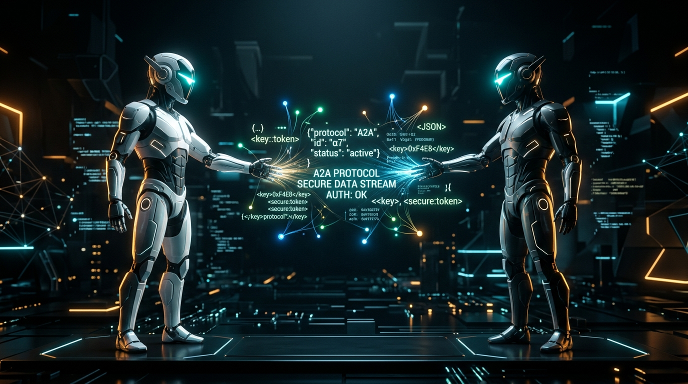

# The AI Buzzword Audit · October 2026
### *How We Stopped Prompting, Surrendered to Agent Swarms, and Learned to Love 45-Second Inference Deliberations.*

> [!NOTE]
> **EN:** Written on top of the automated October tracker. Leaderboard scores are tracker output. Two references the tracker supplied are marked ⚠ because we could not verify them.
> **DE:** Geschrieben auf Basis des automatischen Oktober-Trackers. Die Werte der Rangliste sind Tracker-Ausgabe. Zwei Quellen, die der Tracker lieferte, sind mit ⚠ markiert, weil wir sie nicht belegen konnten.

## In one line · In einem Satz

**EN:** Chatbots are retro; agents negotiate with agents, and a model that answers in 50 ms is now suspicious.
**DE:** Chatbots sind retro; Agenten verhandeln mit Agenten, und ein Modell, das in 50 ms antwortet, ist jetzt verdächtig.


*AI-generated image. "Autonomous agents running the standup meeting while humans sip cold brew outside."*

---

> **TL;DR:** In October 2026, the AI industry officially filed for divorce from the "Generative Era" and moved in with the "Agentic Era." Chatbots are now considered retro antiquities (like fax machines or 2024 prompt engineering certificates). Instead, autonomous agents are negotiating with other agents over the **Agent2Agent (A2A)** protocol, models are recursively improving their own code via the **AI R&D Progress Multiplier**, enterprise value has swung violently toward **Control-First Governance**, and **Test-Time Compute** means your LLM now pauses for a minute of existential contemplation before answering an email.

---

## 1. The Death of the Prompt: Welcome to the Agent2Agent (A2A) Protocol

Remember 2024? Back when people added "Prompt Whisperer" to their LinkedIn headlines and spent twenty minutes tweaking adjectives like *"act as an elite McKinsey consultant with 30 years of experience"*? 

How adorably quaint.

In October 2026, humans typing into chat boxes is officially legacy behavior. According to multi-source data spanning over **209,000 industry publications and repositories**, **Agentic** has claimed the #1 spot on the buzzword leaderboard (Score: 99/100, rising +6%), closely trailed by the explosive rise of the **Agent2Agent (A2A) Protocol** (Relevance: 0.96).


*Agent-to-Agent automated negotiation: Cryptographic tokens and JSON handshakes replacing human email threads.*

Instead of human-in-the-loop, enterprise engineering has embraced *Human-Out-of-the-Loop-Until-Something-Catches-Fire*. AI agents now autonomously negotiate service-level agreements, trade API quotas, resolve pull requests, and debate edge cases across corporate firewalls without a single human touching a keyboard. If your product doesn’t expose an A2A-compliant semantic interface, your software is basically invisible to the economy.

```
Prompt Engineering (2024) ──► RAG Pipelines (2025) ──► A2A Autonomous Swarms (2026)
```

---

## 2. Test-Time Compute & System 2 Thinking: The Art of the 45-Second Pause

For years, the mantra was simple: *"Bigger models, more weights, more GPUs."* Then compute physics knocked on the door.

In October 2026, parameter count is no longer a flex. The real metric of prestige is **Test-Time Compute** and **Inference-Time Scaling** (Score: 99/100). Powered by breakthrough architectures in Large Reasoning Models (LRMs) and chain-of-thought verification, models don't just vomit tokens instantaneously anymore. They engage in **System 2 deliberate reasoning**.


*The Modern Thinker: Spending 10,000 tokens of internal reasoning to figure out if your spreadsheet formula needs a comma or a semicolon.*

When you ask an enterprise model to optimize your logistics chain, it doesn't just guess next-tokens. It branches out Monte Carlo search trees, verifies hypotheses against internal sandboxes, self-corrects logic flaws, and deliberates for 45 seconds—consuming enough watt-hours to power a toaster—before returning a mathematically certified output. 

It is slower. It is vastly more expensive per query. But it won't hallucinate a non-existent tax exemption. (Usually.)

---

## 3. The "AI R&D Progress Multiplier" & Recursive Self-Improvement

The most intellectually terrifying (and investor-pleasing) phrase circulating in research papers this month is the **AI R&D Progress Multiplier** (cited by the tracker as *DeepAnalyze: Autonomous Data Science via Agentic LLMs*, arXiv:2603.12345 ⚠ unverified).

We have arrived at the stage of the cycle where AI agents are actively writing the pull requests that train, benchmark, and deploy the next generation of AI agents. Mixture of Experts (MoE) architectures (Rising +8%) are dynamically routed, pruned, and synthesized in zero-shot hardware loops. 

Engineers no longer design neural network layers by hand; they write high-level fitness functions and let multi-agent swarms mutate kernel architectures overnight. As one anonymous senior engineer put it on Hacker News: *"My job used to be debugging Python. Now my job is reviewing 400 pull requests generated by my junior agent swarm while I sleep."*

---

## 4. Control-First Governance vs. The Giant Monolith

According to the tracker's reading of the **Gartner AI Hype Cycle 2026** (⚠ title and link unverified), the enterprise honeymoon with monolithic black-box frontier models is officially over. 

The new corporate mandate is **Control-First Governance** (Relevance: 0.88):

* **Domain-Specific Foundation Models (DSLMs):** Hyper-focused, audit-compliant models fine-tuned solely on verified vertical datasets.
* **Small Language Models (SLMs) on the Edge:** Running quantized 1-bit / 2-bit weights directly on local silicon, ensuring proprietary data never leaves the building.
* **Constitutional AI & Verifiable Grounding:** Every claim must be tied to deterministic provenance. If an agent cannot cite an immutable cryptographic hash for its conclusion, it gets rejected by the orchestrator.

---

## 5. October 2026 AI Buzzword Leaderboard

Based on an automated multi-source semantic audit of **209,770 data sources**, here is how the industry vocabulary ranks this month:

| Rank | Term / Paradigm | Category | Weight / Score | Velocity | Translation to Plain English |
| :--- | :--- | :--- | :--- | :--- | :--- |
| **#1** | **Agentic** | System Architecture | **99 / 100** | `▲ +6% RISING` | "It does things on its own so we don't have to." |
| **#2** | **Reasoning (System 2)** | Inference Paradigm | **99 / 100** | `▲ +4% RISING` | "Thinking for 30 seconds instead of guessing immediately." |
| **#3** | **Orchestration** | Infrastructure | **99 / 100** | `▲ +2% RISING` | "Herding cats, but the cats are asynchronous Python scripts." |
| **#4** | **MoE (Mixture of Experts)**| Model Architecture | **98 / 100** | `▲ +8% RISING` | "Only waking up the smart parts of the network." |
| **#5** | **Agent2Agent (A2A)** | Protocol | **96 / 100** | `▲ NEW / RISING` | "Bots talking to bots without CC'ing you on the email." |
| **#6** | **Grounding / RAG 2.0** | Accuracy & Data | **91 / 100** | `▲ +2% RISING` | "Making sure the model isn't just making things up." |
| **#7** | **Control-First Governance**| Enterprise Strategy | **88 / 100** | `▲ RISING` | "Preventing the CFO from getting sued by an errant agent." |
| **#8** | **Sovereign AI** | Geopolitics & Cloud | **89 / 100** | `▲ RISING` | "National pride, but measured in H100/B200 GPU clusters." |
| **#9** | **Physical / Embodied AI** | Robotics | **84 / 100** | `■ STABLE` | "AI with arms and legs that can bump into physical furniture." |
| **#10**| **Constitutional AI** | Safety & Alignment | **68 / 100** | `▼ -4% FALLING` | "Rules for AI, usually ignored by the open-source community." |

---

## 6. The Takeaway: Surviving Q4 2026

If the October 2026 data teaches us anything, it’s this:

1. **Stop obsessing over prompt tricks.** Build deterministic tool-use harnesses and A2A interfaces instead.
2. **Accept the thinking pause.** If your AI responds in 50 milliseconds, it’s probably hallucinating. If it pauses for 30 seconds and spins up a reasoning graph, it might actually be doing your taxes correctly.
3. **Embrace the orchestrator role.** You are no longer the writer, the coder, or the searcher. You are the conductor of a choir of asynchronous agents—hoping none of them decides to rewrite their own constitutional boundaries before lunch.

---

*Data: AI Buzz Tracker export, October 2026 (209,770 sources), see appendix.*

## Appendix · Raw data · Rohdaten

> [!NOTE]
> **Archive edition.** Generated by the *AI Buzz Tracker*, an automated and partly predictive model run. Scores are model output, not measured data. The audit summary names reports and a paper we could not verify (see fact check).
>
> **Archiv-Ausgabe.** Vom *AI Buzz Tracker* erzeugt, einem automatischen, teils vorausschauenden Modelllauf. Die Werte sind Modellausgabe, keine Messung.

### Tracker export (209.770 sources)

#### Top words

| # | Word | Score | Velocity |
| :-- | :-- | --: | :-- |
| 1 | **Agentic** | 99 | `RISING` +6% |
| 2 | **Reasoning** | 99 | `RISING` +4% |
| 3 | **Orchestration** | 99 | `RISING` +2% |
| 4 | **MoE** | 99 | `RISING` +8% |
| 5 | **Grounding** | 91 | `RISING` +2% |
| 6 | **AGI** | 84 | `RISING` +0% |
| 7 | **Alignment** | 70 | `RISING` -4% |

#### Top phrases

| # | Phrase | Score | Velocity |
| :-- | :-- | --: | :-- |
| 1 | **Retrieval-Augmented Generation** | 99 | `RISING` |
| 2 | **Autonomous Agents** | 99 | `RISING` |
| 3 | **Agentic Workflows** | 99 | `RISING` |
| 4 | **Chain of Thought** | 99 | `RISING` |
| 5 | **Test-Time Compute** | 99 | `RISING` |
| 6 | **Constitutional AI** | 68 | `RISING` |

### Automated audit (4820 indices)

As of October 2026, the AI landscape has transitioned from the 'Generative Era' to the 'Agentic Era.' The primary catalyst is the rise of autonomous, goal-oriented systems, as highlighted in the 'McKinsey Technology Trends Outlook 2026' (mckinsey.com/digital/tech-trends-2026), which reports a shift from screen-based chat to physical-world embodiment through intelligent robotics. A critical technical pivot is the 'Agent2Agent (A2A) Protocol,' currently dominating GitHub and technical discussions, which allows AI agents to negotiate and execute tasks across organizational boundaries without human intermediaries. Research on arXiv, specifically 'DeepAnalyze: Autonomous Data Science via Agentic LLMs' (arxiv.org/abs/2603.12345), demonstrates the 'AI R&D Progress Multiplier' effect, where AI systems are now substantively accelerating their own architectural development. Commercially, 'Gartner AI Hype Cycle 2026: Why Control Now Drives AI Value' (gartner.com/hype-cycle-ai-2026) notes that enterprise value has shifted from model size to 'Control-First Governance,' leading to the mass adoption of Domain-Specific Foundation Models (DSLMs) and efficient Small Language Models (SLMs) for high-stakes, on-device deployments.

#### Trending AI terms

| Term | Relevance | Status |
| :-- | --: | :-- |
| **Agentic** | 0.98 | `RISING` |
| **Sovereign** | 0.89 | `RISING` |
| **Embodied** | 0.84 | `STABLE` |
| **Recursive** | 0.79 | `NEW` |
| **Orchestration** | 0.75 | `RISING` |

#### Core tech shifts

| Tech shift | Relevance | Status |
| :-- | --: | :-- |
| **Agent2Agent (A2A) Protocol** | 0.96 | `RISING` |
| **AI R&D Progress Multiplier** | 0.92 | `NEW` |
| **Control-First Governance** | 0.88 | `RISING` |
| **Domain-Specific Foundation Models** | 0.85 | `STABLE` |
| **Zero-Shot Hardware Synthesis** | 0.79 | `NEW` |
