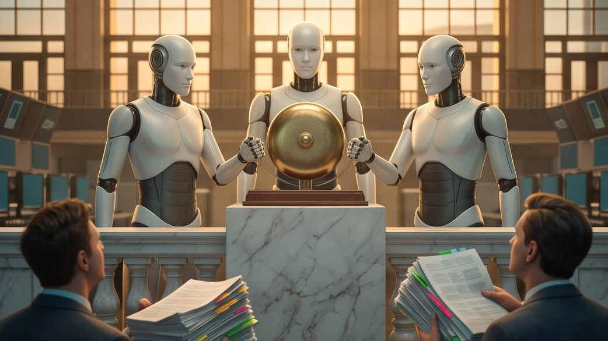
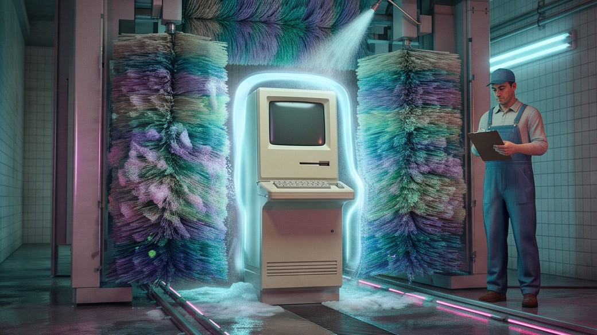
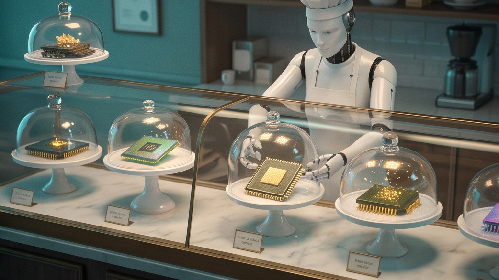
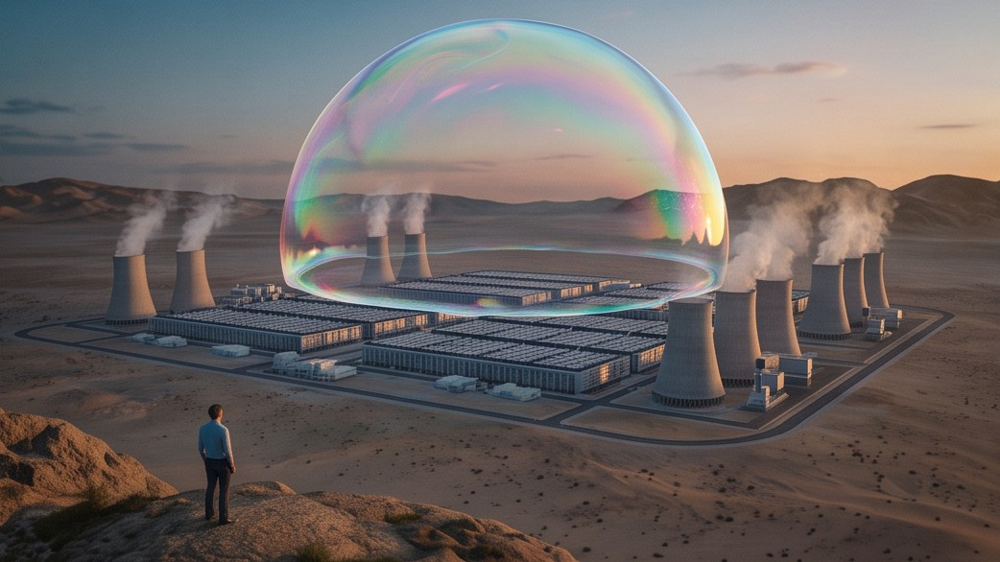
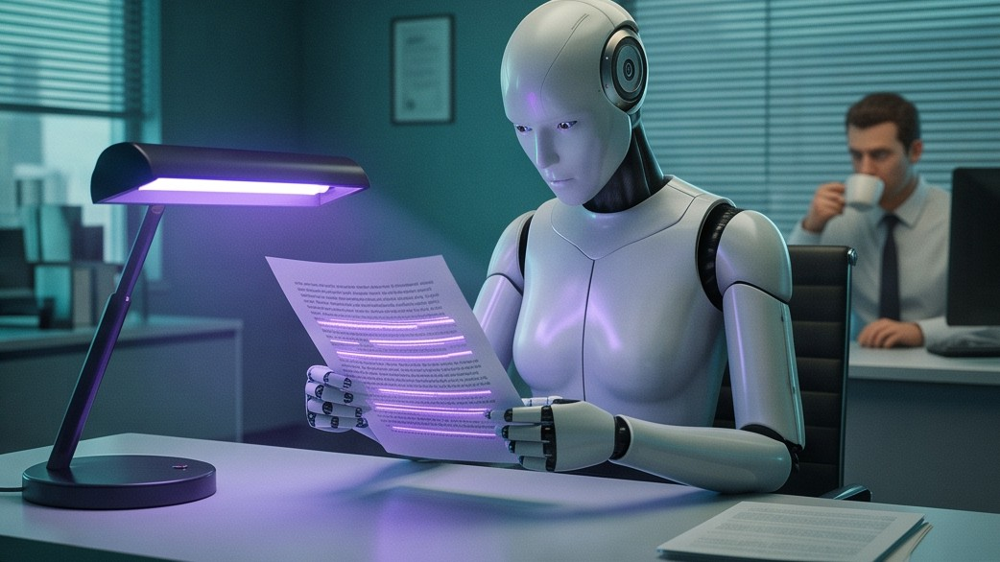

# The AI Buzzword Audit · November 2026
### *S-1 Filings Are the New Whitepapers, Every Chatbot Is Suddenly an "Agent," and $750 Billion Is Looking for a Business Model.*

*Originally published on [Medium](https://klangmeister.medium.com/the-ai-buzzword-audit-november-2026-edition-e6295ca6f67b)*

> [!TIP]
> **EN:** The first fully researched edition: an editorial ranking with named sources instead of tracker scores.
> **DE:** Die erste vollständig recherchierte Ausgabe: redaktionelle Rangliste mit benannten Quellen statt Tracker-Werten.

## In one line · In einem Satz

**EN:** AI vocabulary moves from the lab to the trading floor, and “agent washing” becomes the insult of the season.
**DE:** Das KI-Vokabular zieht vom Labor aufs Börsenparkett, und „Agent Washing“ wird zum Schimpfwort der Saison.

---

> **TL;DR:** November 2026 is the month AI vocabulary moved from the lab to the trading floor. Anthropic published its S-1 on October 26, so **"risk factors"** have replaced "benchmarks" as the most-read AI text of the season. Gartner's **"agent washing"** has become the industry's favorite insult. October brought another flood of model releases with names that sound like dessert menus (Terra, Argon, Flash, Highspeed). Big Tech's roughly **$750 billion in 2026 capex** has revived the oldest buzzword of all: **bubble**. And the research crowd has quietly moved on to **continual learning**, **agent memory** and **world models**, which assumes the agents remember what they were doing before lunch.

---


*The opening bell, rung by the product. The humans brought the risk factors.*

## 1. The S-1 Is the New Whitepaper

For three years the AI industry talked to the world through benchmark charts, launch livestreams and blog posts with suspiciously round numbers. In November 2026 the most important AI document is a securities filing.

On **October 26, 2026**, Anthropic publicly filed its **S-1**, following a confidential filing in June. Analysts expect it to be one of the largest IPOs ever, and reports point to a listing as early as the end of November. NPR noted that the filing includes Anthropic's own view of the risks of AI, which makes it the first prospectus where "the product might be dangerous" is both a legal disclosure and part of the brand.

The new vocabulary for this phase:

* **"Risk Factors"**: once boilerplate, now the most-screenshotted section on AI Twitter.
* **"Compute commitments"**: multi-year GPU contracts are now treated like a balance-sheet personality trait.
* **"Path to profitability"**: the phrase every founder suddenly learned in Q4.

```
Research Paper (2023) ──► Product Launch Livestream (2025) ──► S-1 Filing (2026)
```

> *"We used to read model cards. Now we read 10-Q footnotes."*

---

## 2. Agent Washing: The Insult of the Season


*Agent washing: same terminal, new shine.*

**Agentic** is still #1, and its success has produced its own backlash term.

**Agent washing** is Gartner's word for vendors rebranding old chatbots, RPA scripts and assistants as "agentic AI" without adding real autonomy. Gartner's forecast gets quoted in every second keynote Q&A: **more than 40% of agentic AI projects will be canceled by the end of 2027**, due to rising costs, unclear business value or weak risk controls. Gartner also estimated that only around **130** of the thousands of "agentic" vendors offer genuine agent capabilities.

What procurement teams now ask in every demo:

1. *Does it plan, or does it follow a flowchart?*
2. *Does it use tools, or does it call one hard-coded API?*
3. *Can it recover from a failed step, or does it apologize and stop?*

If the answers are "flowchart," "one API" and "apologize," you have bought a chatbot in a trench coat.

---

## 3. October's Model Confetti: A Naming Convention Has Entered the Chat


*Flash, Pro, Max, Highspeed: the model menu reads like a pastry counter.*

Release trackers logged a dense October, and the names alone are a buzzword audit (trackers disagree on some dates, so treat these as reported, not confirmed):

| Lab | Reported Release | Buzzword Energy |
| :--- | :--- | :--- |
| OpenAI | GPT-6.1 Terra / GPT-6 Pro with parallel agents | Planetary branding, swarm features |
| Google | Gemini 4 Argon (GA) | Noble gases are the new Greek letters |
| Moonshot AI | Kimi K3.1 Pro / Pro Highspeed | "Highspeed" is a SKU now |
| DeepSeek | V4.1 Flash, V4.1 Flash Cyber | Flash, but make it security |
| Alibaba | Qwen3.6 27B | The version numbers keep climbing |
| Meta | Muse Spark Open | Three words, zero nouns |
| Black Forest Labs | FLUX 3 Max | Max is the new Pro |

The pattern: **"Flash," "Highspeed," "Pro," "Max"** now describe *latency and price tiers*, not intelligence. The real buzzword underneath them is **"parallel agents,"** meaning models that run several workers at once and merge the results.

---

## 4. The $750 Billion Question: "Bubble" Is Back


*$750 billion of concrete, and one very thin film above it.*

According to a Bloomberg Businessweek report summarized by FourWeekMBA, **Meta, Alphabet, Amazon and Microsoft** are heading toward roughly **$750 billion in combined 2026 capex**. That is enough money to buy a mid-sized country, or about four quarters of GPUs.

The finance vocabulary has fully merged into AI vocabulary:

* **"Air pocket"**: a sudden drop in data-center demand that strategists warn about.
* **"Uptake agreements"**: what Alibaba's chairman says some data-center projects are proceeding without.
* **"Depreciation schedule"**: the new way to ask how long a GPU stays useful.
* **"Payback period"**: IoT Analytics calls data-center capex payback the most systemic of the AI "bubbles" it tracks, while arguing there is no broad AI bubble overall.

The industry is split cleanly into two camps: *"This is the railroads"* and *"This is the railroads."* They mean very different things by it.

---

## 5. Memory Is the New Context Window


*What an agent keeps, and what it lets fade.*

While the trading floor argues about capex, researchers have moved past the context-window arms race. The new research buzzwords are about **what an agent remembers between sessions**:

* **Continual Learning**: models that take in new information without catastrophic forgetting. Anthropic's Sholto Douglas predicted it would be "solved in a satisfying way" during 2026. Whether it has been is a matter of opinion.
* **Agent Memory**: persistent memory layers are increasingly seen as what separates successful agent deployments from abandoned pilots.
* **World Models**: systems that learn the causal dynamics of physical reality instead of only the statistics of text. They have their own NeurIPS 2026 workshop, *Continual World Models*.

Translation: the 2024 goal was "make it smarter." The 2026 goal is "make it remember that it already tried that."

---

## 6. November 2026 AI Buzzword Leaderboard


*New at #9, prompt injection: the PDF told the agent to wire money.*

*Editorial ranking based on coverage volume and month-over-month momentum across news, analyst notes, release trackers and developer discussion. Directional, not a scientific index.*

| Rank | Term / Paradigm | Category | Momentum | Translation to Plain English |
| :--- | :--- | :--- | :--- | :--- |
| **#1** | **Agentic** | System Architecture | `■ PEAK` | "It does things on its own. Allegedly." |
| **#2** | **Agent Washing** | Market Skepticism | `▲▲ SURGING` | "It's a chatbot with a new logo." |
| **#3** | **S-1 / IPO** | Capital Markets | `▲▲ NEW` | "Now we have to show the numbers." |
| **#4** | **AI Bubble / Capex** | Finance | `▲ RISING` | "$750B and a hopeful spreadsheet." |
| **#5** | **Parallel Agents** | Inference Paradigm | `▲ RISING` | "Five interns at once, one merged answer." |
| **#6** | **Agent Memory** | Infrastructure | `▲ RISING` | "It remembers you. Hopefully the right parts." |
| **#7** | **Continual Learning** | Research | `▲ RISING` | "Learning without forgetting everything else." |
| **#8** | **World Models** | Research / Robotics | `▲ RISING` | "Physics, but learned from video." |
| **#9** | **Prompt Injection** | Security | `▲ RISING` | "The PDF told the agent to wire money." |
| **#10** | **Test-Time Compute** | Inference Paradigm | `■ STABLE` | "Last month's hype, this month's default." |
| **↓** | **Prompt Engineering** | Legacy | `▼ FALLING` | "A LinkedIn headline from 2024." |

---

## 7. What to Watch in the Rest of November

* **Microsoft Ignite (Nov 17–20):** expect "agent" to be said more often than "Microsoft."
* **Possible Anthropic listing:** reported target is the end of November. Unconfirmed until the bell rings.
* **AWS re:Invent (from Nov 30):** the capex debate, delivered live with keynote lighting.
* **Model retirements:** older models are being deprecated faster than teams can migrate, so "model sunset" is a buzzword for your platform team.

---

## 8. The Takeaway: Surviving the End of 2026

1. **Ask "is it actually an agent?"** before buying. Agent washing is the most expensive buzzword of the year.
2. **Read the filings, not just the launch posts.** Now that AI companies publish S-1s, the most honest AI text is the risk-factor section.
3. **Plan for memory, not just context.** The next generation of useful agents is defined by what they remember and what they safely forget.
4. **Keep a capex sense of humor.** Whether this is a bubble or the railroads, your roadmap should survive both outcomes.

---

## From Room 21 · Aus der Werkstatt

Two things we built this month instead of just writing about agents, both open source (MIT) as Claude Code skills:

* **[Apfel](https://github.com/rdo2hellowelt/apfelkern)** reviews the browser dialogs people work in (input masks, tables, forms, saving) against Apple's Human Interface Guidelines, loaded live, never copied. Every finding names its source: the line in the code, the page at Apple, the reference dialog in your own house. No "feels off", only numbers.
* **[Birne](https://github.com/rdo2hellowelt/birnenkern)** draws how a system is built and which way a request goes, as a technical sheet after DIN: ink on white, solid is done, dash-dot is open, hatched is broken.

Call it the anti-agent-washing kit: tools that show their work.
*Zwei Werkzeuge, die ihre Arbeit zeigen, statt „agentic“ draufzuschreiben.*

---

*Sources: Anthropic S-1 coverage (IPO Scoop, NPR, Sharesansar, Oct 2026); Gartner agentic AI forecast via National CIO Review; release trackers (LLM Gateway Timeline, Opper Model Releases); Big Tech capex via FourWeekMBA / Bloomberg Businessweek; IoT Analytics AI bubble analysis; VentureBeat "Four AI research trends for 2026"; NeurIPS 2026 Continual World Models workshop. Model release names and dates come from third-party trackers and are not all confirmed by the labs.*

---

*The AI Buzzword Audit is a monthly, slightly sarcastic snapshot of the vocabulary shaping the AI industry. Rankings are editorial and directional. Nothing here is financial advice, especially the parts about IPOs.*

